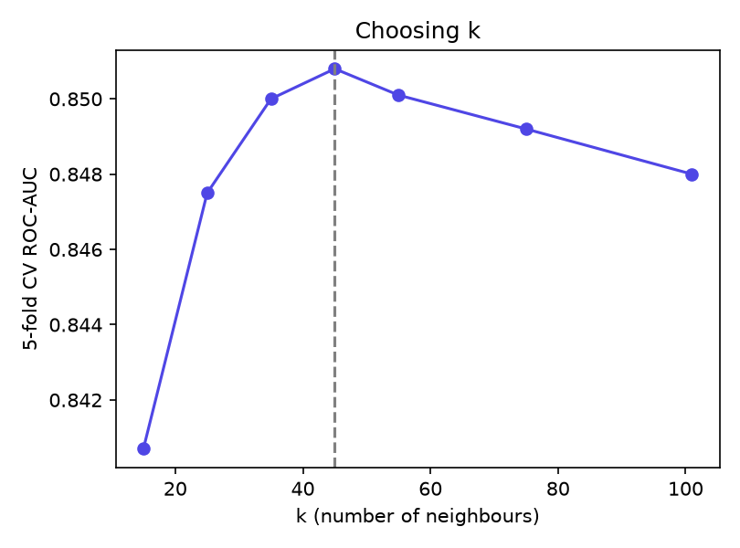
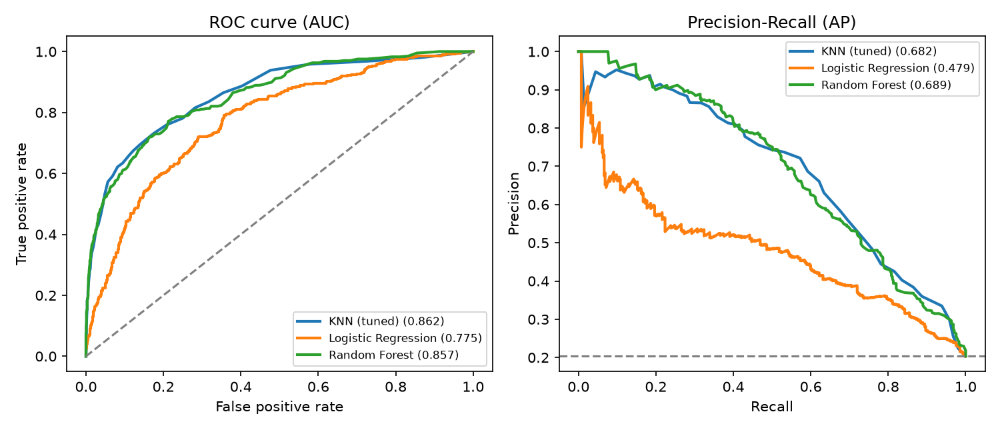
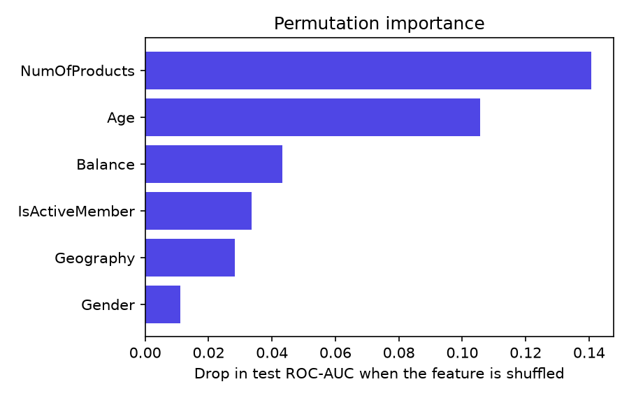

# 🏦 Bank Customer Classification using KNN

A complete machine-learning project that classifies bank customers as **likely to leave (churn) or likely to stay** using the **K-Nearest Neighbours** algorithm. It includes a tuned scikit-learn pipeline, a **from-scratch NumPy KNN**, a web app that explains every prediction by showing **the most similar customers**, a batch CSV classifier, a REST API and tests.

**Tech:** Python · scikit-learn · pandas · NumPy · matplotlib · Flask · pytest

## Highlights
- 🎯 **Everything that matters for KNN is handled and demonstrated:** feature scaling, one-hot encoding, choosing *k*, distance metric (L1/L2), neighbour weighting, feature selection, class imbalance
- 🔬 **Cross-validated tuning** over feature set × k × weights × metric (training data only); **decision threshold chosen from CV predictions**, never from the test set
- 📈 **Honest evaluation:** held-out test set + 5×3 repeated CV, ROC-AUC *and* PR-AUC (the data is 80/20 imbalanced), baseline comparison, permutation importance
- 🧮 **KNN implemented from scratch** (`knn_scratch.py`) and verified to match scikit-learn exactly
- 🔍 **Naturally explainable:** each prediction shows how many of the *k* most similar customers left, plus the closest matches
- 🌐 Web UI, JSON API, single-customer CLI, batch CSV tool; input validation; 11 tests

## Quick start
```bash
git clone https://github.com/sayyad-shahin/bank-customer-classification-knn.git
cd bank-customer-classification-knn
python -m venv venv && source venv/bin/activate      # Windows: venv\Scripts\activate
pip install -r requirements.txt
python app.py                                         # open http://127.0.0.1:5000
```
A trained model is included. To retrain and regenerate all metrics and plots: `python train.py`
(also do this if you see a scikit-learn version-mismatch error).

```bash
python predict.py --example high                                  # one customer (CLI)
python predict_csv.py data/sample_input.csv predictions.csv       # many customers
pytest                                                            # tests
```

### API
```bash
curl -X POST localhost:5000/api/predict -H "Content-Type: application/json" \
  -d '{"Age":52,"Geography":"Germany","Gender":"Female","Balance":120000,"NumOfProducts":1,"IsActiveMember":0}'
```
Returns `probability`, `risk_level`, `flagged`, `neighbors_churned` / `neighbors_total`, the `closest` customers and `warnings`. Invalid input returns HTTP 400 with `errors`. Other endpoints: `GET /api/schema`, `GET /api/model`, `GET /health`.

## Dataset
The widely used public **"Churn Modelling"** bank-customer dataset (as distributed on Kaggle): **10,000 customers**, 2,037 (20.4 %) churned. Features: credit score, country (France/Germany/Spain), gender, age, tenure, balance, number of products, has credit card, is active member, estimated salary. `RowNumber` and `Surname` were removed (no predictive value). It is a teaching dataset, so it is included for educational use; check the original source's terms before reusing it commercially.

## Method
1. **Preprocess:** `StandardScaler` for numeric/binary columns, one-hot encoding for country and gender - inside the pipeline, so nothing leaks from validation folds
2. **Tune with 5-fold CV** (scoring ROC-AUC) over 3 candidate feature sets × k ∈ {15…101} × {uniform, distance} weights × {Manhattan, Euclidean}
3. **Pick the alert threshold** (0.29) that maximises F1 on cross-validated *training* predictions
4. **Evaluate** on the untouched 20 % test set and with repeated CV on all data
5. **Deploy** the same settings refitted on all 10,000 customers

### Why scaling and feature choice matter for KNN
KNN is distance-based, so features on large scales dominate and irrelevant features add noise. In my experiments (all features, k = 25, 5-fold CV ROC-AUC):

| Setup | CV ROC-AUC |
|---|---|
| No scaling | 0.545 (almost random) |
| MinMax scaling | 0.771 |
| **StandardScaler** | **0.833** |

Feature sets chosen by CV: all 10 features **0.837** → drop salary & tenure **0.844** → **core 6 features 0.851** (Age, Balance, NumOfProducts, IsActiveMember, Geography, Gender). Winning settings: **k = 45, Euclidean distance, uniform weights.**

## Results
Majority-class baseline accuracy: **79.7 %**.

| Evaluation | ROC-AUC | PR-AUC |
|---|---|---|
| 5×3 repeated CV, all data | **0.856** ± 0.010 | 0.672 ± 0.018 |
| Held-out test set (2,000 customers) | **0.862** | 0.682 |

**Test set at the chosen threshold (0.29):** accuracy 84.2 %, precision 60.0 %, **recall 66.1 %**, F1 62.9 %; confusion matrix `[[1414, 179], [138, 269]]`.
**Why not the default 0.5?** At 0.5 the model reaches 86.1 % accuracy but finds only **42.5 %** of leavers (precision 79.4 %). A bank usually prefers catching more at-risk customers for a cheap retention offer, so the threshold is lowered - a business trade-off you can change in `train.py`.

**Comparison on the same test set** (Logistic Regression and Random Forest use default settings and all features - not tuned, so this is context, not a full benchmark):

| Model | ROC-AUC | PR-AUC |
|---|---|---|
| **KNN (tuned)** | 0.862 | 0.682 |
| Random Forest | 0.857 | 0.689 |
| Logistic Regression | 0.775 | 0.479 |

KNN clearly beats the linear model because churn is *non-linear* (e.g. customers with 3-4 products leave far more often than those with 2), and it is on par with an untuned forest.

| Choosing k | ROC / PR curves | Feature importance |
|---|---|---|
|  |  |  |

**What drives predictions** (permutation importance, drop in AUC): number of products (0.141), age (0.106), balance (0.043), active-member status (0.034), country (0.028), gender (0.011).

## Project structure
```
app.py                Flask app + API           train.py             tuning, evaluation, plots, saving
predict.py            validation + prediction   knn_scratch.py       NumPy KNN from scratch
predict_csv.py        batch classification      common.py            features, form spec, data loading
templates/index.html  web UI                    data/                dataset + sample_input.csv
models/               saved model + metrics     reports/             generated plots     tests/
```

## Limitations
- **KNN stores all training data** and compares every query to it: prediction cost grows with dataset size and the model file contains the reference table. Fine for 10k rows; for millions use an index (KD-tree/FAISS) or a different model.
- Sensitive to scaling and irrelevant features, and to the curse of dimensionality - that is why feature selection helped.
- Small, clean, teaching dataset (the same few features, no time dimension). Real churn data is messier and drifts over time.
- **Fairness:** the model uses *gender* and *country*. In a real bank this could be legally and ethically problematic; gender is the least important feature here and is easy to remove (`FEATURE_SETS` in `common.py`).
- The "similar customers" shown are anonymised dataset records; a production system must follow privacy rules.

## Future work
Tune Random Forest / gradient boosting properly · probability calibration · SHAP · cost-sensitive threshold using real retention costs · approximate nearest-neighbour search · Docker + cloud deployment

## Author
**Shahin Sayyad** · [LinkedIn](https://linkedin.com/in/shahin-sayyad1) · [GitHub](https://github.com/sayyad-shahin)

## License
MIT (code). Dataset © original source; included for educational use.
